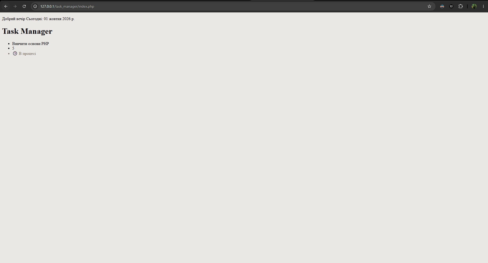

```php
function formatTitle($text, $maxLength = 20) {
    if (mb_strlen($text) > $maxLength) {
        return mb_substr($text, 0, $maxLength) . '...';
    }
    return $text;
}

function getCurrentGreeting() {
    $hour = (int)date('H');

    if ($hour >= 6 && $hour < 12) {
        return "Доброго ранку";
    } elseif ($hour >= 12 && $hour < 18) {
        return "Добрий день";
    } elseif ($hour >= 18 && $hour < 24) {
        return "Добрий вечір";
    } else {
        return "Доброї ночі";
    }
}
```
